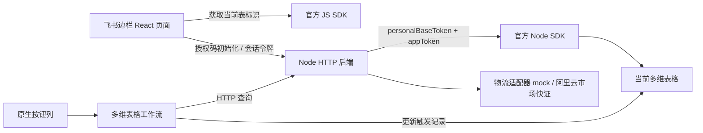

# 运单助手开发文档

版本：0.1 / 2026-09-15

## 1. 总体架构



真实飞书模式的主要读写链路使用 Node SDK；JS SDK 用于宿主标识读取。`src/base.ts` 另保留前端直接读写适配示例，当前主界面不使用它来写表。

**appToken 是多维表格标识，personalBaseToken 是该 Base 的授权码。两者都不是企业自建应用 App ID / App Secret，也不需要 tenant_access_token。** 官方 Node 接入示例采用 `new BaseClient({ appToken, personalBaseToken })`。[Node SDK 文档](https://www.npmjs.com/package/@lark-base-open/node-sdk)

前端参考官方 React 模板；后端参考官方 MCP 服务器中的 BaseService 接入模式。MCP 服务器是官方后端参考，**并非官方提供的完整快递查询后台**；本工程的 HTTP 路由、会话、物流和业务逻辑为新建代码。[官方后端参考](https://github.com/Lark-Base-Team/lark-base-mcp-node-server)

## 2. 技术栈与目录

| 组件 | 版本/文件 | 职责 |
|---|---|---|
| React / TypeScript | 18.3.1 / 5.9.3 | 状态、配置和运单界面 |
| Vite | 8.3.0 | 开发代理、静态构建 |
| 官方 JS SDK | 1.0.2 | 当前 Base/table 识别，独立适配示例 |
| 官方 Node SDK | 1.0.1 | personalBaseToken 授权的表格 API |
| Node | 验证版本 24.19.0 | 原生 HTTP 服务、测试 |
| `server/sessions.mjs` | 内存会话 | 一小时 TTL、随机令牌、验证后签发 |
| `server/base-gateway.mjs` | BaseGateway | 字段初始化、分页读取、单行查询写回 |
| `server/service.mjs` | 查询适配边界 | 校验、限流、统一结果文本、错误码 |
| `server/providers/aliyun-kzexpress.mjs` | 当前真实物流适配 | APPCODE、表单请求、轨迹映射、30 分钟缓存 |
| `server/providers/kuaidi100.mjs` | 真实物流适配 | 自动识别、SHA256 签名、轨迹映射、30 分钟缓存 |
| `server/index.mjs` | API/静态服务 | JSON 解析、鉴权、路由、错误响应 |
| `src/Sidebar.tsx` | 实际飞书边栏入口 | 宿主识别、表切换隔离、授权、单行/批量查询、主题 |
| `src/App.tsx` | 独立测试页 | 通过 ?demo=1 进入，模拟表格展示 |

版本由 pnpm-lock.yaml 固定。官方 SDK 的历史依赖包含旧版 axios、已弃用 lodash 子包，发布前须进行依赖审计和升级兼容测试，不能以本次构建成功代替安全审查。

## 3. 凭证处理

1. 浏览器提交 `mode=feishu`、appToken、tableId、personalBaseToken 至同源 `/api/connect`。
2. 使用独立 BaseClient，只访问所绑定 tableId；先列出字段验证权限。
3. 成功后生成 32 字节随机会话令牌，浏览器仅内存保存；后端保留会话对应客户端，1 小时过期、每分钟清理。
4. 请求中不允许覆盖会话绑定的表格；前端切换表格须断开并重新连接。
5. 断开删除会话；重启丢失所有会话。GC 清理时机不等于物理内存立即擦除。
6. Demo 模式不创建 BaseClient，不能访问 `/api/base/*`。

正式版：HTTPS、凭证加密存储（KMS/密钥服务）、租户/安装绑定、可撤销授权、细粒度范围、日志脱敏、鉴权入口限流、持久任务配额。用户撤销飞书授权码后，后端后续 SDK 调用应失败并要求重新连接。当前不会将用户授权码发送给物流供应商。

## 4. API 契约

除 health 外均为 POST，Content-Type 为 application/json，业务请求需 `Authorization: Bearer <sessionToken>`。请求体上限 8KB。错误统一为：

```json
{"error":{"code":"FIELD_MAPPING","message":"请选择两个不同的文本字段"}}
```

| 接口 | 请求 | 响应摘要 |
|---|---|---|
| GET `/api/health` | 无 | ok、providerMode、providerConfigured、productionReady=false |
| `/api/connect` | mode；飞书模式还需 appToken、tableId、personalBaseToken | token、expiresAt、mode、fields |
| `/api/disconnect` | `{}` | ok |
| `/api/base/initialize` | `{}` | mapping、fields、buttonRequiresWorkflow=true |
| `/api/base/rows` | mapping：number、info，可选 carrier、phone | rows 列表 |
| `/api/base/query-record` | recordId、mapping、carrier、phone | 查询结果、resultText、written=true |
| `/api/query` | number、carrier、phone | 查询结果、resultText；不写表 |
| `/api/workflow/query` | number、carrier、phone | 与 query 相同，供工作流更新触发记录 |

`carrier` 可省略，默认自动识别；阿里云模式将其映射为 `cpCode`。`phone` 映射为 `mobile`，顺丰、中通和跨越提供完整 11 位手机号或后四位。真实与模拟结果使用同一契约：

```json
{
  "number":"JD002938475610",
  "carrier":"京东",
  "mock":true,
  "summary":"【模拟数据】京东 · 运输中 · 快件已到达分拨中心",
  "queriedAt":"2026-09-15T05:00:00.000Z",
  "events":[{"time":"2026-09-15T04:00:00.000Z","content":"【模拟数据】快件已到达分拨中心"}],
  "resultText":"快递公司：京东\n运单号：JD002938475610\n最新信息：【模拟数据】京东 · 运输中 · 快件已到达分拨中心\n查询时间：2026-09-15T05:00:00.000Z\n物流轨迹：\n2026-09-15T04:00:00.000Z  【模拟数据】快件已到达分拨中心"
}
```

错误：400 参数/字段问题，401 会话失效，404 暂无轨迹，409 编辑冲突，413 请求过大，415 Content-Type，422 不支持承运商，429 限流，502 飞书业务错误，503 真实服务商未配置，500 未知服务错误。

## 5. 表格读写约定

- 字段初始化使用 Node SDK `appTableField.list/create`；类型 `1` 为文本。
- 字段映射配置保存 ID，调用前重新查字段元数据，再使用当前字段名调用 Node 记录 API。
- Node API 记录 fields 的 key 是字段名；JS SDK 的 key 是字段 ID，不要混用。
- Node 分页使用 `page_token`/`has_more`；JS SDK 示例使用 `pageToken`/`hasMore`。[官方 Table API](https://lark-base-team.github.io/js-sdk-docs/zh/api/table)
- Node 后端每页 100 条；循环至 has_more=false，拒绝相同或缺失的继续游标。
- 写回仅更新结果字段，绝不把整个旧 record 回传覆盖其他字段。
- 写回前复读输入和旧结果，避免覆盖查询期间已变更的数据；仍非原子 compare-and-set。
- 初始化只建两列。SDK 类型里虽出现 Button UI 类型，但 1.0.2 的 Button 配置类型不完整，不能据此硬编码数字类型或假设绑定工作流能力。
- 默认边栏 appToken/tableId 由官方 SDK 获取。切表事件清空会话、停止后续查询、重置字段映射；后端已发请求仍绑定原表。用 revision 排除旧请求覆盖新表 UI，异步授权若在切表后才返回则立即注销。

## 6. 批量设计

Demo 使用前端串行队列，550ms 间隔；后端额外提供进程级每分钟 120 次查询限制。空行跳过，不自动重试收费请求，失败重试由用户手动触发。真实适配器按“公司编码 + 单号 + 核验手机号”缓存成功结果 30 分钟；进程重启后缓存清空。

默认边栏在每次单行/批量查询前读取最新记录，独立演示页按已加载快照处理。

前端接口请求 30 秒超时；官方 SDK HTTP 实例 15 秒超时。单条记录整体包含多次 SDK 调用，最坏情况可能超过前端超时，后端已接收的请求仍可能完成写回。出现不确定结果时，先刷新表格确认再重试。生产版必须以 jobId/requestId 查询最终结果并做幂等。

正式版批量建议：`POST /jobs` 创建任务 → 持久数据库保存条目 → 队列 worker 调服务商 → 限流/退避 → 按记录写回 → SSE/轮询展示进度。任务唯一键包含安装标识、表格、记录、单号版本；缓存按承运商+单号+必要核验信息隔离，费用结算与查询结果区分。

## 7. 真实物流适配

当前选择 `PROVIDER_MODE=aliyun_kzexpress`。已实现用户指定接口的 `POST application/x-www-form-urlencoded` 请求、`Authorization: APPCODE ...` 鉴权、字段和轨迹映射、HTTP网关错误及套餐错误处理。

配置位于项目根目录 `.env`：

```dotenv
PROVIDER_MODE=aliyun_kzexpress
ALIYUN_EXPRESS_APPCODE=云市场已购买服务中复制的AppCode
ALIYUN_EXPRESS_APPKEY=
ALIYUN_EXPRESS_APPSECRET=
```

当前使用 APPCODE 简单认证，所以只有 `ALIYUN_EXPRESS_APPCODE` 必填。AppKey/AppSecret 为将来切换阿里云网关签名认证预留，不能混用其他云市场商品的 AppCode。配置后重启，确认 `/api/health` 返回 `providerMode=aliyun_kzexpress`、`providerConfigured=true`。

接口固定为用户指定的 HTTPS 地址；代码拒绝其他协议和域名。测试只验证请求构造、错误处理和响应映射，配置真实 AppCode 后仍需用京东、邮政/EMS、安能、跨越、顺丰真实运单验收。

## 8. 原生按钮与后端授权关系

推荐工作流先查询接口，再由工作流更新本行，无需后台使用任意飞书记录写入权限。当前 `/api/workflow/query` 使用短期会话令牌，只用于 demo。它与页面会话同权限、1 小时有效、重启失效，**不能作为正式的永久工作流密钥**。

正式版应签发独立 workflow credential：只允许物流查询，绑定安装/表格，带撤销与限额；原生按钮在边栏关闭后可独立执行。若要求后端直接更新本行，可对工作流增加专用受限写回接口，不能直接复用未受限公网写表接口。

## 9. 部署与上架门槛

本地单进程：`pnpm build && pnpm start`，静态文件和 API 同源。开发：Vite 5173 代理后端 8787。没有在本任务中部署公网服务。

正式环境：稳定 HTTPS 域名、合法 iframe 嵌入配置、生产环境变量、加密凭证、持久存储、租户隔离、查询供应商和监控。按最新飞书指南核实 CSP/frame-ancestors、网络域名及安装权限；不要误设 X-Frame-Options: DENY。

**当前 NODE_ENV=production 主动拒绝启动，这是 demo 状态标记。不能只删掉这一行就认为已经达到上架标准。**

交付测试见验收记录；真实授权码、真实表格、工作流、物流供应商及市场审核均需要后续联调。

## 10. 边栏加载

根地址 `/` 默认渲染 Sidebar；`/?demo=1` 按需加载独立测试页。当前静态服务未设置阻止 iframe 的 X-Frame-Options，API 同源访问无需跨域白名单。Chrome 对 HTTPS 飞书页加载本地 HTTP 回环地址可能弹出本机网络访问提示，必须由用户确认；正式环境使用 HTTPS 消除对开发者本机服务的依赖。

宿主调用：getSelection、onSelectionChange、getTableById/getName、getTheme/onThemeChange；卸载时解除事件监听。选区变化仅更新记录；表变化销毁旧会话引用。
